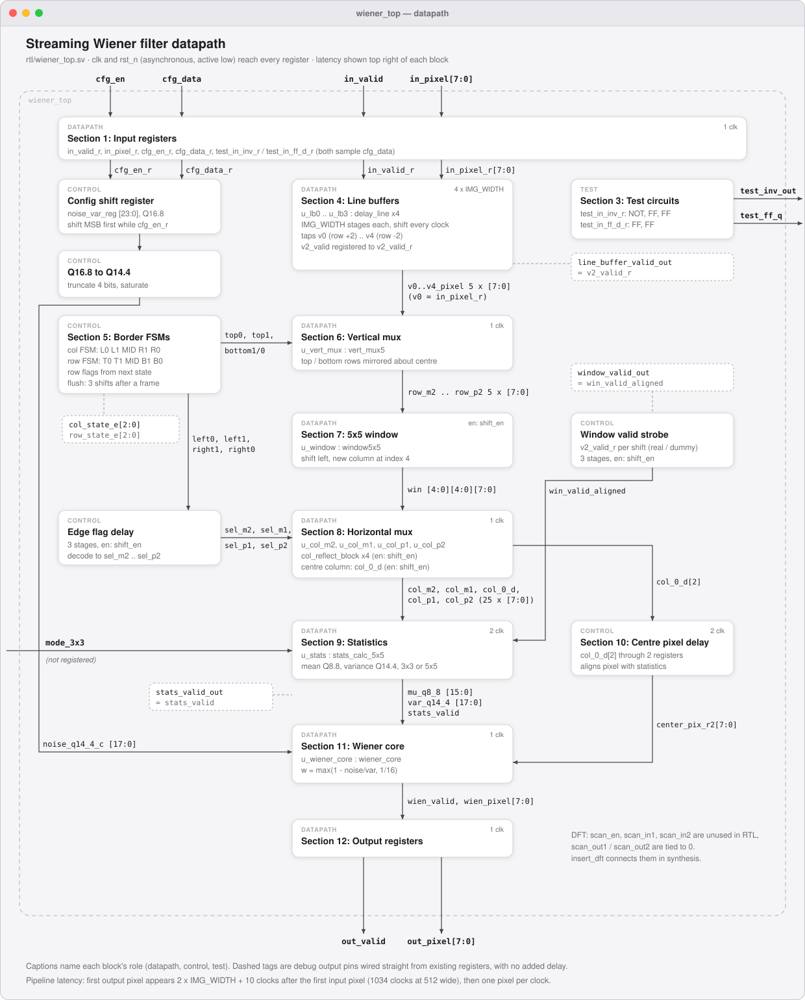
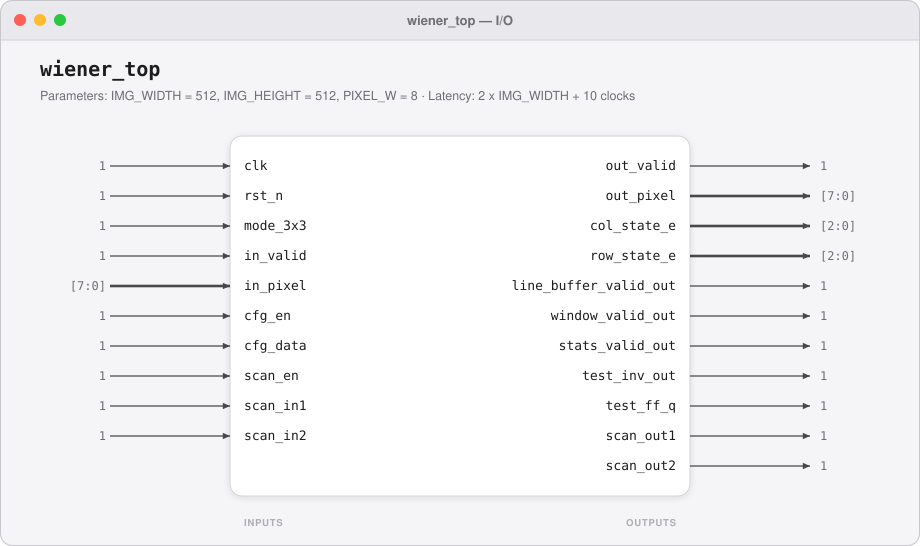

# Wiener Image Denoising Hardware Accelerator

Streaming RTL accelerator for adaptive Wiener image denoising, with a Python evaluation pipeline. Written in SystemVerilog, simulated with Icarus Verilog, evaluated with scikit-image.

## What this is

A hardware accelerator that removes Gaussian noise from grayscale images with a locally adaptive **Wiener filter**. Pixels stream in one per clock in raster order and filtered pixels stream out one per clock, with no frame buffer. The filter estimates the local mean and variance over a 5x5 window (or its centre 3x3) and blends each pixel toward the local mean according to how much of the local variance is noise.

The repository contains:

* The front end RTL in SystemVerilog ([`rtl/`](rtl)), 5x5 and 3x3 statistics modes
* A full image testbench ([`tb/`](tb)) and a bit exact golden model regression ([`tests/`](tests))
* Block diagrams and the I/O of every block ([`docs/ARCHITECTURE.md`](docs/ARCHITECTURE.md))
* A Python flow for noise injection, simulation and quality metrics, plus a GUI

## Results

Measured with this RTL on the included 512 x 512 test image (`clean_image.hex`, `noisy_image.hex`), with `+NOISE_VAR=680.2`, the actual variance of the noise in that image:

| Metric | Noisy input | Restored, 5x5 | Restored, 3x3 |
|---|---|---|---|
| SNR | 14.29 dB | 20.77 dB | 19.70 dB |
| PSNR | 19.80 dB | 26.29 dB | 25.22 dB |
| SSIM | 0.291 | 0.657 | 0.524 |

## Hardware architecture



| Block | File | Job | Latency |
|---|---|---|---|
| Input registers | `wiener_top.sv` | Register every primary input | 1 clk |
| Config shift register | `wiener_top.sv` | Serial load of the noise variance (24 bit Q16.8) | load only |
| Line buffers | `delay_line.sv` x4 | Five vertically aligned rows | 2 x IMG_WIDTH clk |
| Vertical mux | `vert_mux5.sv` | Top and bottom border mirroring | 1 clk |
| 5x5 window | `window5x5.sv` | Sliding window registers | 1 shift |
| Horizontal mux | `col_reflect_block.sv` x4 | Left and right border mirroring | 1 clk |
| Statistics | `stats_calc_5x5.sv` | Local mean (Q8.8) and variance (Q14.4) | 2 clk |
| Wiener core | `wiener_core.sv` | Gain `w = max(1 - noise/var, 1/16)` and output pixel | 1 clk |
| Output registers | `wiener_top.sv` | Register `out_valid` and `out_pixel` | 1 clk |

The first output pixel appears **2 x IMG_WIDTH + 10 clocks** after the first input pixel (1034 clocks at 512 wide). Full port lists, number formats, border handling and per block diagrams are in [`docs/ARCHITECTURE.md`](docs/ARCHITECTURE.md).

### Top level interface



Compared with the previous RTL, this version:

* removes the dedicated test inputs `test_in_inv` and `test_in_ff_d`. Both test circuits now sample `cfg_data`, so `test_inv_out` and `test_ff_q` are the inverted and direct `cfg_data` delayed by 3 clocks.
* adds the FSM observation buses `col_state_e[2:0]` and `row_state_e[2:0]`.
* adds three pipeline valid observation outputs: `line_buffer_valid_out`, `window_valid_out` and `stats_valid_out`.

The new outputs are plain wires from existing registers, with no added flops or delay. Interior pixels are unchanged from the previous RTL. The border fixes listed under [Verification](#verification) change a few pixels at the image edges and make `out_valid` exact.

## Repository structure

```
.
├── rtl/                        Synthesizable RTL
│   ├── rtl.f                   Design file list (synthesis / lint)
│   ├── wiener_top.sv           Top level, FSMs, alignment logic
│   ├── delay_line.sv           Line buffer
│   ├── vert_mux5.sv            Top / bottom border mux
│   ├── window5x5.sv            5x5 sliding window
│   ├── col_reflect_block.sv    Left / right border mux
│   ├── stats_calc_5x5.sv       Local mean and variance
│   └── wiener_core.sv          Wiener gain and output pixel
├── tb/
│   └── tb_wiener_top.sv        Full image testbench (5x5 run, then 3x3 run)
├── tests/
│   ├── golden_model.py         Bit exact Python model of the datapath
│   ├── tb_golden.sv            Self checking testbench
│   └── run_golden.py           Regression: python3 tests/run_golden.py
├── docs/
│   ├── ARCHITECTURE.md         Datapath, timing, formats, I/O of every block
│   └── diagrams/               SVG block diagrams
├── rtl.f                       Simulation file list (rtl/rtl.f + testbench)
├── run.py                      One command flow: image -> RTL sim -> metrics
├── img_to_hex.py               Grayscale, resize, add noise, write HEX
├── reconstruct_image.py        Pixel stream -> image + SNR / PSNR / SSIM
├── reconstruct_image_rgb.py    RGB variant
├── app.py, gui/                Desktop GUI
├── pipeline/, utils/           GUI pipeline steps and helpers
├── Test/                       Python hardware model and parameter search
└── clean_image.hex, noisy_image.hex, *.png   Example 512 x 512 test image
```

## Quick start

Install the Python packages and Icarus Verilog:

```bash
pip install numpy pillow opencv-python scikit-image
sudo apt install iverilog          # macOS: brew install icarus-verilog
```

Run the whole flow:

```bash
python run.py --img path/to/image.jpg --size 512 --snr 14
```

Or run the RTL simulation by hand on the included test image, from the repository root:

```bash
iverilog -g2012 -s tb_wiener_top -o sim.out -f rtl.f
vvp sim.out +NOISE_VAR=680.2
```

`+NOISE_VAR` is the noise variance as a real number. The testbench converts it to Q16.8 and shifts it in through `cfg_en` / `cfg_data`. Optional plusargs `+CLEAN_HEX=`, `+NOISY_HEX=`, `+OUT_5X5=` and `+OUT_3X3=` override the default file names. The outputs are `output_pixels_5x5.txt` and `output_pixels_3x3.txt`, one pixel per line.

Rebuild an image and compute the metrics:

```bash
python reconstruct_image.py --file output_pixels_5x5.txt --out_img restored_5x5.png --size 512 \
    --clean clean_image.hex --noisy noisy_image.hex --restored output_pixels_5x5.txt
```

## Fixed point

The noise variance goes to the hardware as `round(sigma^2 x 256)` (Q16.8, 24 bits) and is converted inside to Q14.4 with saturation. The mean is Q8.8 and the variance is Q14.4. Details are in [`docs/ARCHITECTURE.md`](docs/ARCHITECTURE.md#number-formats).

```
SNR  = 10 log10( sum f^2 / sum (f - f_hat)^2 )
PSNR = 10 log10( 255^2 / MSE )
SSIM = skimage.metrics.structural_similarity(f, f_hat)
```

## Configuration

The image size is set by the `wiener_top` parameters `IMG_WIDTH` and `IMG_HEIGHT` (default 512). The testbench passes them from its `IMG_W` and `IMG_H` local parameters, so change those in `tb/tb_wiener_top.sv` together with `--size` in the Python flow.

## Verification

`tests/golden_model.py` is a bit exact Python model of the RTL fixed point arithmetic and border rule. `tests/run_golden.py` streams generated images through the RTL and compares every output pixel with the model, and also checks that each frame gives exactly IMG_WIDTH x IMG_HEIGHT outputs:

```bash
python3 tests/run_golden.py
```

It covers 13 configurations: image sizes from 8 x 8 to 64 x 48 including odd sizes, both statistics modes, back to back frames, idle gaps between frames (including gaps shorter than the end of frame flush), and noise levels from almost zero up to the weight floor. All 13 pass.

### Fixed bugs

The golden model found three RTL bugs that the full image SNR test could not show. They are fixed in this version:

1. **Row border flags were one pixel late.** The vertical mux used the row state of the previous pixel, so windows at x = 0, 1, 2 on rows 1, 2, H-2 and H-1 used wrong rows. The row flags now come from the FSM's next state.
2. **The end of the stream was not flushed.** The last 3 pixels of a frame repeated an older window. Up to 3 dummy shifts now follow the last pixel of a frame.
3. **`out_valid` stayed high after a frame.** It is now high for exactly one clock per output pixel.

## Known limitations

1. **No idle cycles inside a frame.** The line buffers shift every clock, so `in_valid` must stay high for the whole frame. Gaps between frames are fine.
2. **Border rule differs from the Python reference.** The RTL mirrors about the window centre, while `scipy` `mode="reflect"` in `Wiener_filter.py` repeats the edge pixel. The golden model follows the RTL.

## Roadmap

- [ ] Allow idle cycles inside a frame (valid gated line buffers)
- [ ] Pipeline the Wiener core divider
- [ ] Replace the flop based line buffers with SRAM
- [ ] Synthesis, timing and area results
- [ ] RGB / multi channel support

## Authors

**Alen Faer, Tomer Beck**
Electrical & Computer Engineering
Technion – Israel Institute of Technology

*Project: Hardware Acceleration for Wiener Image Denoising*
