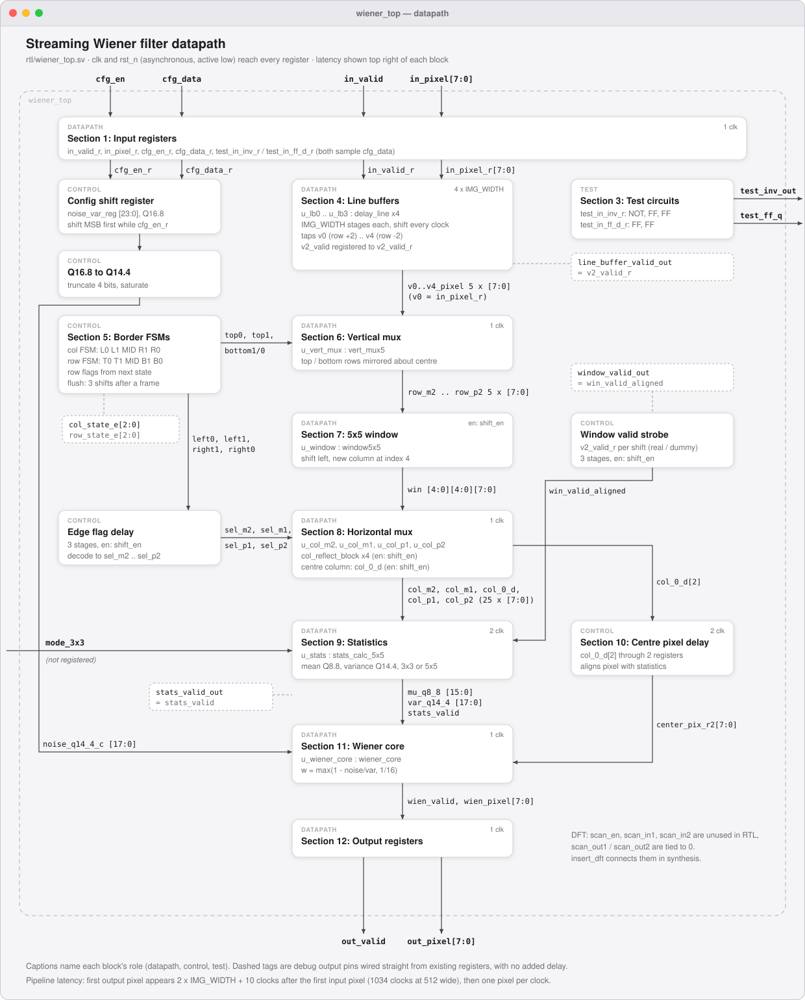
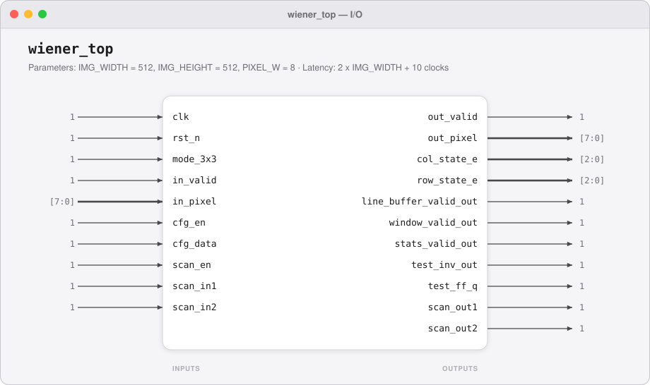
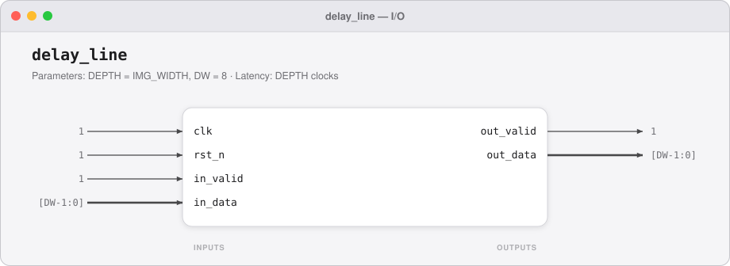
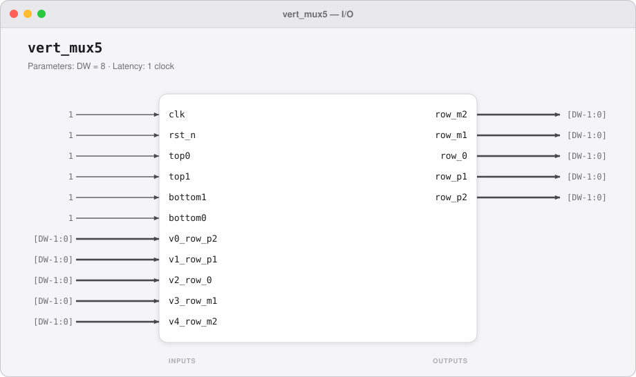
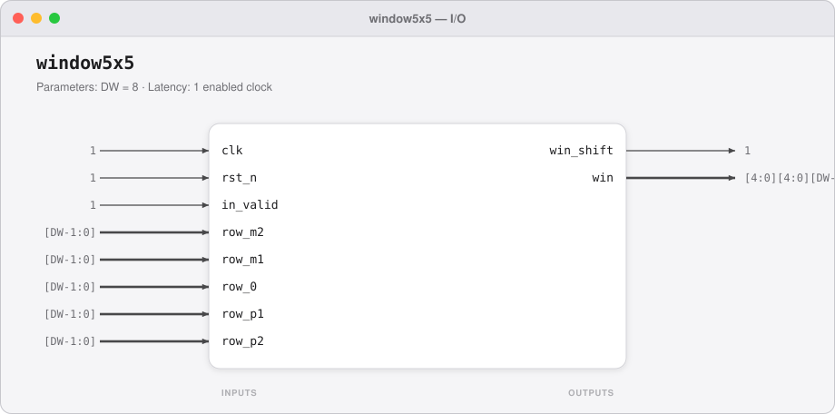
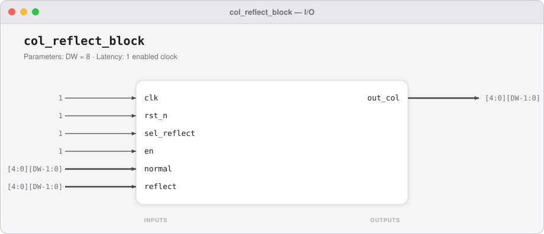
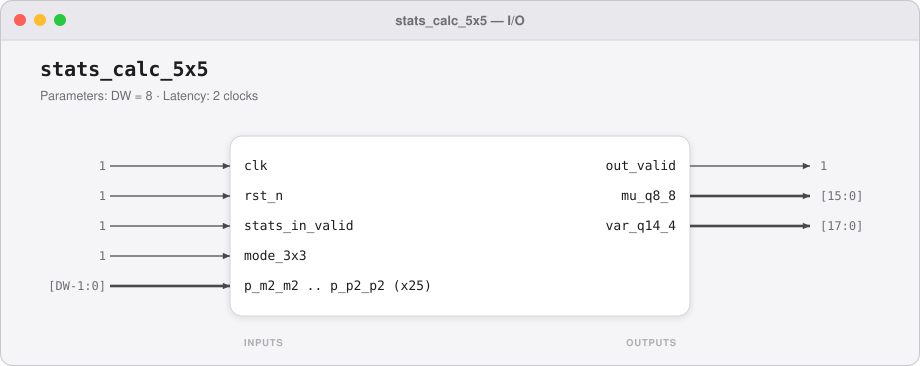
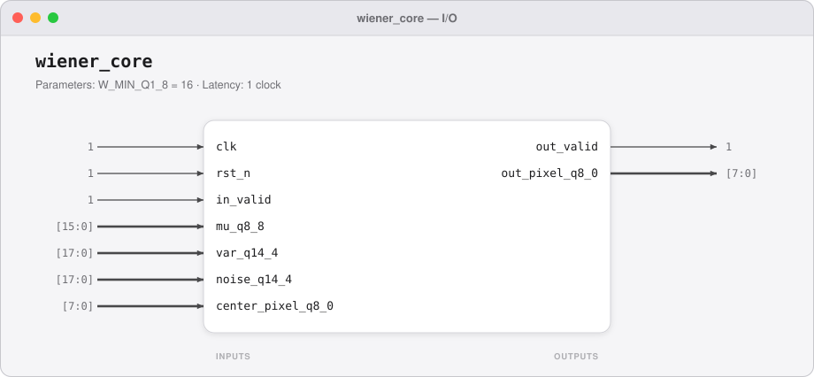

# RTL Architecture

This page documents the front end RTL in [`rtl/`](../rtl): the top level datapath, the I/O of every block, the number formats and the timing. The diagrams in [`docs/diagrams`](diagrams) are SVG and open at full size when clicked.

## Top level datapath



Pixels enter in raster order, one per clock. Four line buffers turn the stream into five vertically aligned rows, with v2 as the centre row. The vertical mux mirrors rows that fall above or below the image. The 5x5 window shifts in one column per valid cycle. The horizontal mux mirrors columns that fall left or right of the image. The statistics block computes the local mean and variance (5x5 or centre 3x3). The Wiener core turns those into a gain and produces the filtered pixel.

Two small state machines track where the window centre is. The column FSM steps once per real window shift (`L0, L1, MID, R1, R0`). The row FSM steps once per row (`T0, T1, MID, B1, B0`). The vertical mux works on the pixel at the line buffer output one clock before that pixel is shifted, so it takes its row flags from the FSM's next state. The column flags go through a 3 stage delay before they drive the horizontal mux, so they line up with the pixel in the window centre.

## Window shift control and valid

`shift_en` moves the window, the column edge flag delay and the horizontal mux registers. It is high when a real pixel is shifted in (`v2_valid_r`) or during a flush shift.

The window centre trails the newest column by two columns and the horizontal mux adds one more shift, so the last pixel of a frame needs 3 more shifts before it is processed. When the next frame follows back to back, its first pixels provide them. Otherwise `flush_shift` inserts up to 3 dummy shifts while no real pixel arrives.

Every shift also records whether its column is real or dummy (`col_real_pipe`). The flag from three shifts back becomes `win_valid_aligned`, a one clock strobe per real centre pixel. It drives the statistics block, so `out_valid` is high exactly once per output pixel and every frame produces exactly IMG_WIDTH x IMG_HEIGHT pixels.

Section numbers in the diagram match the `Section N` comments in [`rtl/wiener_top.sv`](../rtl/wiener_top.sv).

## Pipeline timing

| Stage | Block | Latency | Enable |
|---|---|---|---|
| Input registers | `wiener_top` section 1 | 1 clk | always |
| Line buffers (centre row) | `u_lb0`, `u_lb1` | 2 x IMG_WIDTH clk | always (shift every clock) |
| Vertical mux | `u_vert_mux` | 1 clk | always |
| 5x5 window | `u_window` | 1 shift | `shift_en` |
| Horizontal mux | `u_col_*`, `col_0_d` | 1 clk | `shift_en` |
| Statistics | `u_stats` | 2 clk | always |
| Wiener core | `u_wiener_core` | 1 clk | always |
| Output registers | `wiener_top` section 12 | 1 clk | always |

Measured in simulation, the first `out_valid` comes **2 x IMG_WIDTH + 10 clocks** after the first `in_valid` (1034 clocks for a 512 pixel wide image). After that the design produces one pixel per clock. The first output pixel is the filtered image pixel (0, 0).

The three debug outputs show the valid at three points: `line_buffer_valid_out` first rises at 2 x IMG_WIDTH + 2, `window_valid_out` at 2 x IMG_WIDTH + 6 and `stats_valid_out` at 2 x IMG_WIDTH + 8 clocks after the first input.

## Number formats

| Signal | Format | Range |
|---|---|---|
| `in_pixel`, `out_pixel` | unsigned integer, 8 bit | 0 to 255 |
| `noise_var_reg` (serial config) | unsigned Q16.8, 24 bit | 0 to 65535.996 |
| `noise_q14_4_c` (to the core) | unsigned Q14.4, 18 bit, saturated | 0 to 16383.94 |
| `mu_q8_8` | unsigned Q8.8, 16 bit | 0 to 255.0 |
| `var_q14_4` | unsigned Q14.4, 18 bit, saturated | 0 to 16383.94 |
| Wiener weight `w` | unsigned Q1.8, 9 bit | 16/256 to 1.0 |

The noise variance is loaded by holding `cfg_en` high for 24 clocks and shifting `cfg_data` MSB first. The value is `round(sigma^2 * 256)`.

## Border handling

When the window centre is on one of the two outer rows or columns, a missing neighbour is replaced by its mirror about the **window centre**. For example, at the top row, row -1 is taken from row +1 and row -2 from row +2. At the second row only row -2 is missing and it is taken from row +2. Columns follow the same rule.

This is not the same as `scipy.ndimage` `mode="reflect"` used by the Python reference, which repeats the edge pixel. Border pixels will therefore not match the software model exactly.

## Interface rules

1. Stream a whole frame with `in_valid` high on every clock. The line buffers shift on every clock, so an idle cycle inside a frame misaligns the rows. Idle cycles between frames are fine, and frames can also follow back to back.
2. Keep `mode_3x3` constant during a frame. It is not registered and is used in two pipeline stages.
3. Load the noise variance before the frame starts.

## Block I/O

### wiener_top



| Port | Dir | Width | Description |
|---|---|---|---|
| `clk` | in | 1 | Clock, rising edge |
| `rst_n` | in | 1 | Asynchronous active low reset |
| `mode_3x3` | in | 1 | 1 = statistics over the centre 3x3, 0 = full 5x5 |
| `in_valid` | in | 1 | `in_pixel` is valid |
| `in_pixel` | in | PIXEL_W | Noisy input pixel, raster order |
| `cfg_en` | in | 1 | Shift `cfg_data` into the noise variance register |
| `cfg_data` | in | 1 | Serial noise variance bit, MSB first. Also feeds both test circuits |
| `out_valid` | out | 1 | `out_pixel` is valid |
| `out_pixel` | out | PIXEL_W | Filtered pixel |
| `col_state_e` | out | 3 | Column FSM state: 0 L0, 1 L1, 2 MID, 3 R1, 4 R0 |
| `row_state_e` | out | 3 | Row FSM state: 0 T0, 1 T1, 2 MID, 3 B1, 4 B0 |
| `line_buffer_valid_out` | out | 1 | `v2_valid_r`, a real pixel is shifted into the window |
| `window_valid_out` | out | 1 | `win_valid_aligned`, one clock strobe per window into the statistics block |
| `stats_valid_out` | out | 1 | `stats_valid`, valid into the Wiener core |
| `test_inv_out` | out | 1 | Inverted `cfg_data`, 3 clocks after the pin |
| `test_ff_q` | out | 1 | `cfg_data`, 3 clocks after the pin |
| `scan_en`, `scan_in1`, `scan_in2` | in | 1 each | DFT scan, unused in RTL |
| `scan_out1`, `scan_out2` | out | 1 each | DFT scan, tied to 0 in RTL |

The debug outputs are plain wires from existing registers. They add no flops and no delay.

To use the test circuits on silicon, hold `cfg_en = 0` and `in_valid = 0` and toggle `cfg_data`. The noise variance register keeps its value while `cfg_en` is low.

| Parameter | Default | Meaning |
|---|---|---|
| `IMG_WIDTH` | 512 | Image width, also the line buffer depth |
| `IMG_HEIGHT` | 512 | Image height |
| `PIXEL_W` | 8 | Pixel width. The statistics and core are written for 8 bits |

### delay_line



A shift register that delays a pixel and its valid bit by `DEPTH` clocks. It shifts on every clock and is not gated by `in_valid`. Four instances form the line buffer chain.

| Port | Dir | Width | Description |
|---|---|---|---|
| `clk`, `rst_n` | in | 1 | Clock and asynchronous active low reset |
| `in_valid` | in | 1 | Valid bit travelling with the pixel |
| `in_data` | in | DW | Input pixel |
| `out_valid` | out | 1 | `in_valid` delayed by DEPTH clocks |
| `out_data` | out | DW | `in_data` delayed by DEPTH clocks |

### vert_mux5



Selects the five pixels of the new window column and handles the top and bottom borders. The output is registered (1 clock).

| Port | Dir | Width | Description |
|---|---|---|---|
| `clk`, `rst_n` | in | 1 | Clock and asynchronous active low reset |
| `top0`, `top1` | in | 1 | Centre row is image row 0 / 1 |
| `bottom1`, `bottom0` | in | 1 | Centre row is image row H-2 / H-1 |
| `v0_row_p2` | in | DW | Row +2 tap (input stream) |
| `v1_row_p1` | in | DW | Row +1 tap (line buffer 0) |
| `v2_row_0` | in | DW | Row 0 tap (line buffer 1, centre) |
| `v3_row_m1` | in | DW | Row -1 tap (line buffer 2) |
| `v4_row_m2` | in | DW | Row -2 tap (line buffer 3) |
| `row_m2` .. `row_p2` | out | DW each | Window column after border handling |

| Flag | Replacement |
|---|---|
| `top0` | row -2 from +2, row -1 from +1 |
| `top1` | row -2 from +2 |
| `bottom0` | row +2 from -2, row +1 from -1 |
| `bottom1` | row +2 from -2 |

### window5x5



A 5x5 register array, `win[row][col]`. When `in_valid` is high (`shift_en` in the top level) every row shifts one column left and the new pixel enters at column 4. The centre pixel is `win[2][2]`. `win_shift` goes high on the first shift and stays high. The top level leaves it unconnected and tracks validity per column instead.

| Port | Dir | Width | Description |
|---|---|---|---|
| `clk`, `rst_n` | in | 1 | Clock and asynchronous active low reset |
| `in_valid` | in | 1 | Shift in a new column |
| `row_m2` .. `row_p2` | in | DW each | New column, top to bottom |
| `win_shift` | out | 1 | Sticky "window has shifted" flag |
| `win` | out | 5 x 5 x DW | Window contents |

### col_reflect_block



A 5 wide 2:1 mux plus an enabled register. It chooses between a window column and its mirror about the centre column. Four instances handle columns -2, -1, +1 and +2.

| Port | Dir | Width | Description |
|---|---|---|---|
| `clk`, `rst_n` | in | 1 | Clock and asynchronous active low reset |
| `sel_reflect` | in | 1 | 1 = mirrored column, 0 = normal column |
| `en` | in | 1 | Register enable (`shift_en`) |
| `normal` | in | 5 x DW | Normal column, index 0 = top |
| `reflect` | in | 5 x DW | Mirrored column, index 0 = top |
| `out_col` | out | 5 x DW | Registered selected column |

| Instance | Normal | Mirror | Select |
|---|---|---|---|
| `u_col_m2` | column -2 | column +2 | `L0` or `L1` |
| `u_col_m1` | column -1 | column +1 | `L0` |
| `u_col_p1` | column +1 | column -1 | `R0` |
| `u_col_p2` | column +2 | column -2 | `R1` or `R0` |

### stats_calc_5x5



Computes the local mean and variance in two pipeline stages. Stage 1 squares the 25 pixels and sums pixels and squares with adder trees, split into the centre 3x3 and the outer ring. Stage 2 divides by 9 or 25 with a constant reciprocal multiply, computes `E[x^2] - mu^2`, and converts the variance to Q14.4 with saturation.

| Port | Dir | Width | Description |
|---|---|---|---|
| `clk`, `rst_n` | in | 1 | Clock and asynchronous active low reset |
| `stats_in_valid` | in | 1 | The 25 pixel inputs are valid |
| `mode_3x3` | in | 1 | 1 = centre 3x3, 0 = full 5x5 |
| `p_<r>_<c>` | in | DW each | 25 window pixels, `r` and `c` in `m2, m1, 0, p1, p2` |
| `out_valid` | out | 1 | Results valid (2 clocks after `stats_in_valid`) |
| `mu_q8_8` | out | 16 | Local mean, Q8.8 |
| `var_q14_4` | out | 18 | Local variance, Q14.4, saturated |

| Constant | Value | Meaning |
|---|---|---|
| `MU_RECIP_9` | 1864136 | ceil(2^24 / 9), mean shift 16 |
| `MU_RECIP_25` | 671089 | ceil(2^24 / 25), mean shift 16 |
| `EX2_RECIP_9` | 238609295 | ceil(2^31 / 9), E[x^2] shift 23 |
| `EX2_RECIP_25` | 85899346 | ceil(2^31 / 25), E[x^2] shift 23 |

### wiener_core



Computes the Wiener gain and the output pixel, then registers the result (1 clock).

```
R   = noise / max(var, 1 LSB)                  8 fraction bits
w   = (R >= 236/256) ? 0 : 1 - R               Q1.8
w   = max(w, W_MIN_Q1_8)                       W_MIN_Q1_8 = 16 (0.0625)
out = clamp(mu + w * (pixel - mu), 0, 255)     integer part of the Q8.8 result
```

| Port | Dir | Width | Description |
|---|---|---|---|
| `clk`, `rst_n` | in | 1 | Clock and asynchronous active low reset |
| `in_valid` | in | 1 | Inputs are valid |
| `mu_q8_8` | in | 16 | Local mean, Q8.8 |
| `var_q14_4` | in | 18 | Local variance, Q14.4 |
| `noise_q14_4` | in | 18 | Noise variance, Q14.4 |
| `center_pixel_q8_0` | in | 8 | Noisy centre pixel |
| `out_valid` | out | 1 | `in_valid` delayed by 1 clock |
| `out_pixel_q8_0` | out | 8 | Filtered pixel |

The divider (26 bit by 18 bit) is fully combinational and is the longest path in the design.
